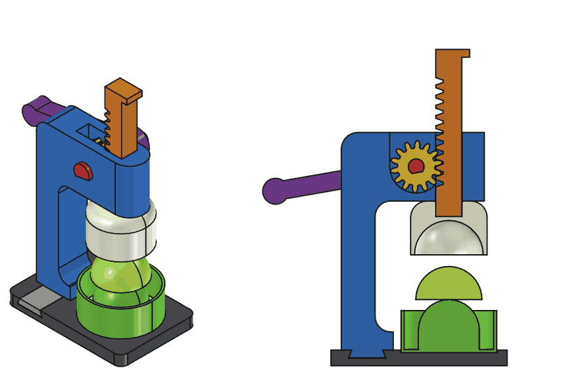

# Text2Model

Describe a mechanism in plain text and have it built as a real, editable parametric
model in [FreeCAD](https://www.freecad.org/): sketches, pads, pockets, holes, revolves,
patterns, all driven from a spreadsheet, then checked and exported as print-ready STLs.



## What's here

| Path | Contents |
|---|---|
| `freecad_bridge/` | FreeCAD add-on that lets an external process run Python inside the open FreeCAD GUI (localhost:52525), so models are built live, feature by feature |
| `t2m/cad.py` | Helpers: spreadsheet parameters, fully constrained expression-driven sketches, PartDesign features, assembly checks (validity, interference, build volume), print orientation, plate layout, STL/STEP export, section views |
| `t2m/client.py` | Sends a script to the bridge and journals every step to `journal/` (replayable) |
| `designs/lime_press.py` | Lime-juicing arbor press: rack and pinion, dovetailed frame, juice cup with dome, cup-shaped plunger, spring-clipped handle. Every dimension lives in the `Params` spreadsheet |
| `designs/lime_press_*.py` | Verification (parameter sweeps, full-motion collision sweep, dovetail play), plate layout, STL export, animation |
| `out/limepressv1plates/` | Print-ready plates: two at 40% infill, one at 100% |
| `out/limepressv1parts/` | One print-oriented STL per part |
| `out/lime_press/lime_press.FCStd` | The editable FreeCAD model |

## Running it

Requires FreeCAD 1.1 (tested with the snap package).

```bash
ln -s "$PWD/freecad_bridge" ~/snap/freecad/common/Mod/Text2ModelBridge   # once: install the bridge
./launch_freecad.sh                                                       # start FreeCAD
python3 -m t2m.client designs/lime_press.py                               # build the press live
python3 -m t2m.client designs/lime_press_verify.py                        # re-verify
```

To change the design, edit a yellow cell in the `Params` spreadsheet in FreeCAD and press
Ctrl+R, or change the defaults in `designs/lime_press.py` and rebuild.

Printer assumed: FDM, 0.4 mm nozzle, 180 x 180 x 100 mm build volume. Clearances are
spreadsheet parameters; tune them to your printer.

## License

This repository uses two licenses:

| What | License | File |
|---|---|---|
| Code and docs: everything **outside** `out/` (`t2m/`, `freecad_bridge/`, `designs/`, `journal/`, scripts) | [MIT](https://opensource.org/license/mit) | [`LICENSE`](LICENSE) |
| Models and media: everything **in** `out/` (FreeCAD `.FCStd`, `.step`, `.stl`, plates, images, animation) | [CC BY 4.0](https://creativecommons.org/licenses/by/4.0/) | [`out/LICENSE`](out/LICENSE) |

Both require attribution. For the models, credit them like this:

> "Text2Model" by Emil DeVries (https://github.com/Emil-DV/Text2Model), licensed under CC BY 4.0

and indicate if you made changes. For the code, keep the MIT copyright and license notice
in copies or substantial portions of it.
